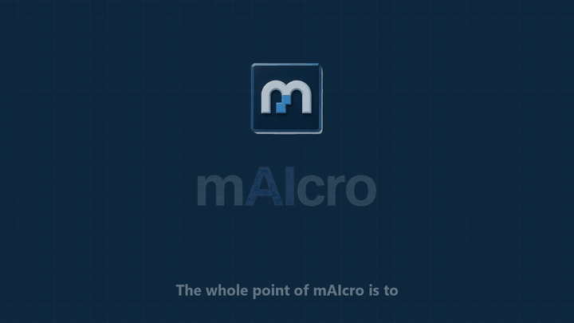

# mAIcro site redesign (M.B edit)

A static redesign of [maicro.app](https://maicro.app), with the promo video, the site walkthrough and the brand assets used to build it.

## Videos

Each preview below is a short, silent excerpt. Click a preview to open the full 1080p MP4.

### 1. Promo video: "mAIcro in under three minutes" (YouTube explainer)

[](video/mAIcro-explainer.mp4)

- **File:** [`video/mAIcro-explainer.mp4`](video/mAIcro-explainer.mp4), 2:56, 1920x1080, H.264 + AAC, 19.8 MB.
- **What it is:** a 16:9 explainer for YouTube, cut from the Team Bloxez walkthrough videos. It covers installing mAIcro, learning in the built-in help, mAIpads, and AI on your own files. Captions and highlight boxes are part of the picture.
- **Where it's used:** it's the demo video on the redesigned home page (`website/site/media/maicro-explainer.mp4`). Its poster frame is [`video/mAIcro-explainer-poster.jpg`](video/mAIcro-explainer-poster.jpg).

### 2. Site walkthrough: tour of the redesigned site

[](video/mAIcro-site-walkthrough.mp4)

- **File:** [`video/mAIcro-site-walkthrough.mp4`](video/mAIcro-site-walkthrough.mp4), 1:04, 1920x1080, H.264, no audio, 18.1 MB.
- **What it is:** a screen recording of this site running locally. It shows:
  - the home page;
  - the demo video playing;
  - every page, opened through the footer links;
  - "Ask your agent" and `llms.txt`;
  - each external footer link: YouTube, GitHub, Discord, Docker Hub, LinkedIn and the founder's GitHub.
- **Preview:** the GIF above plays the whole walkthrough at double speed.

## What's here

| Path | Contents |
|---|---|
| `website/site/` | The built site: plain HTML, CSS and a little JavaScript. This folder is what you deploy. |
| `website/content/` | Page sources, plus course and story data (`courses.json`, `stories.json`, `stories/*.html`). |
| `website/tools/` | `build_site.py` rebuilds `site/` from `content/`. `check_site.py` checks links, console errors and layout. `test_build_site.py` holds the tests. |
| `website/research/` | Copy and design sources: the Carbon v2 copy (PDF/HTML), `SITE_COPY.md`, competitor and pain-point notes, and live-site design notes. |
| `brand/` | The original logo sheet (`logo-sheet.png`) and the logo files cut from it (`logos/`). |
| `video/` | Promo video and its poster, the site walkthrough, and the README preview. |

`website/site/README.md` has page-by-page sources, script notes and editing details.

### Video files

| File | What it is |
|---|---|
| `video/mAIcro-explainer.mp4` | Promo video, the YouTube explainer (2:56, 1080p) |
| `video/mAIcro-explainer-poster.jpg` | Poster frame for the promo video, used on the home page |
| `video/mAIcro-explainer-preview.gif` | Silent 15-second excerpt of the promo video, shown in this README |
| `video/mAIcro-site-walkthrough.mp4` | Site walkthrough (1:04, 1080p, no audio) |
| `video/mAIcro-site-walkthrough-preview.gif` | The walkthrough at double speed, shown in this README |

### Brand files

| File | Size (px) | What it is |
|---|---|---|
| `brand/logo-sheet.png` | 1983 x 793 | Original logo sheet. All the files below are cut from it. |
| `brand/logos/logo-lockup.png` | 1283 x 244 | Icon and wordmark side by side. Used in the site header. |
| `brand/logos/logo-wordmark.png` | 890 x 223 | "mAIcro" wordmark only, with AI in blue |
| `brand/logos/logo-mark.png` | 365 x 244 | The "m" mark only, no background |
| `brand/logos/logo-app-icon.png` | 421 x 417 | App icon: the "m" mark on a dark rounded tile |
| `brand/logos/icon-512.png` | 512 x 512 | App icon, 512 px square, ready for a web app manifest. The site doesn't use it yet. |
| `brand/logos/icon-192.png` | 192 x 192 | App icon, 192 px square, ready for a web app manifest. The site doesn't use it yet. |
| `brand/logos/apple-touch-icon.png` | 180 x 180 | iPhone/iPad home-screen icon |
| `brand/logos/favicon-32.png` | 32 x 32 | Browser tab icon |

## Preview locally

```sh
cd website/site
python -m http.server 8000
# open http://localhost:8000/
```

`http.server` has no byte-range support, so you can't seek in the demo video locally. Seeking works on a real host.

## Rebuild after editing

Requires Python 3.12+. `check_site.py` also needs Playwright (`pip install playwright pytest`, then `playwright install chromium`).

```sh
cd website
python tools/build_site.py                    # content/ -> site/
python tools/check_site.py                    # links, console errors, overflow at 1280 px and 390 px
python -m pytest tools                        # tests
```

## Deploy

The site is static, so any static host works: Netlify, Cloudflare Pages, Vercel, GitHub Pages, S3 or nginx. Publish `website/site/` as the web root. There is no build step on the host.

- `blog/` contains redirect pages, so the live site's `/blog` and `/blog/<slug>` links still work after the move to `/stories/`.
- `404.html` uses root-relative links. Most hosts serve it automatically for missing pages.
- GitHub Pages needs a public repo or a paid plan. This repo is private.

## Before publishing

- Remove "Draft redesign. Facts checked…" from the footer (`website/tools/build_site.py`, `render_footer`), then rebuild.
- The promo video uses the founder's own YouTube footage. Get their OK before publishing it.
- The Carbon copy says 15 courses, but the live catalogue lists 14. Decide which is right.
- The Carbon copy says to install Docker first, but the live install page says the setup script handles Docker. Both appear on `get-started.html`, so confirm with the founder.
- Re-check the **[check]** items in `website/research/SITE_COPY.md` (version, image size, local-model support, licence).
